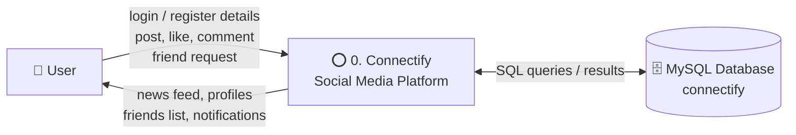
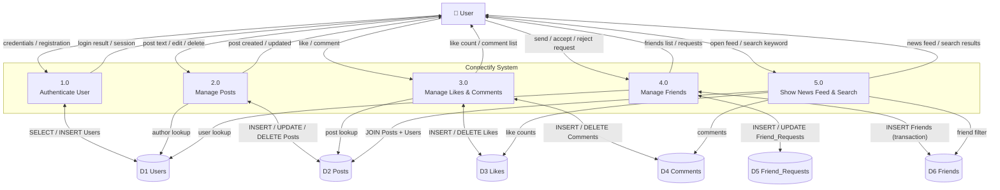

# Connectify — Data Flow Diagrams (DFD)

## Level 0 — Context Diagram

One process (the whole Connectify system), two external entities, one data store
shown as a single database.



**External entities:** User (the only actor — registers, logs in, posts, likes,
comments, manages friends).
**Data flows in:** registration details, login credentials, post content,
like/unlike actions, comments, friend requests, search keywords, profile edits.
**Data flows out:** news feed, like counts, comments, friends list, suggested
friends, search results, profile pages.
**Data store:** MySQL database `connectify` (6 tables).

## Level 1 — DFD (system broken into processes)



## Level 1 — Data stores

| Store | Table(s) | Read / written by |
|---|---|---|
| D1 Users | Users | 1.0 Authenticate, 2.0 Posts (author), 4.0 Friends, 5.0 Feed/Search |
| D2 Posts | Posts | 2.0 Manage Posts, 3.0 Likes & Comments, 5.0 Feed |
| D3 Likes | Likes | 3.0 Likes & Comments, 5.0 Feed (counts) |
| D4 Comments | Comments | 3.0 Likes & Comments, 5.0 Feed |
| D5 Friend_Requests | Friend_Requests | 4.0 Manage Friends |
| D6 Friends | Friends | 4.0 Manage Friends, 5.0 Feed (whose posts to show) |

## Process descriptions (Level 1)

| Process | Input | Processing | Output | Tables |
|---|---|---|---|---|
| 1.0 Authenticate User | email, password / registration form | Validate (AuthService), check credentials (UserDAO.login), create session | Session + redirect to feed, or error | Users |
| 2.0 Manage Posts | post text, post_id | INSERT / UPDATE / DELETE via PostDAO; trigger updates Users.post_count | Confirmation, updated feed | Posts, Users |
| 3.0 Manage Likes & Comments | post_id, comment text | Toggle like (UNIQUE prevents duplicates), add/delete comment | New like count, comment list | Likes, Comments |
| 4.0 Manage Friends | receiver_id / request_id | Send request; accept = transaction inserting both Friends rows + updating request status (COMMIT/ROLLBACK) | Friends list, pending requests | Friend_Requests, Friends |
| 5.0 Show News Feed & Search | user_id, search keyword | JOIN Posts+Users, filter to self + friends, ORDER BY date/likes; LIKE search on Users | News feed, search results, suggestions | Posts, Users, Likes, Comments, Friends |
```

